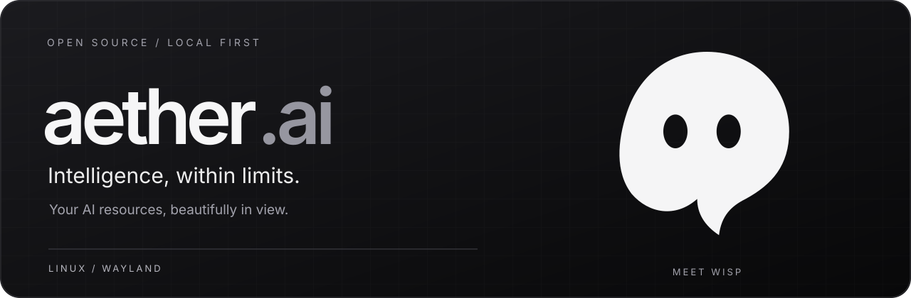
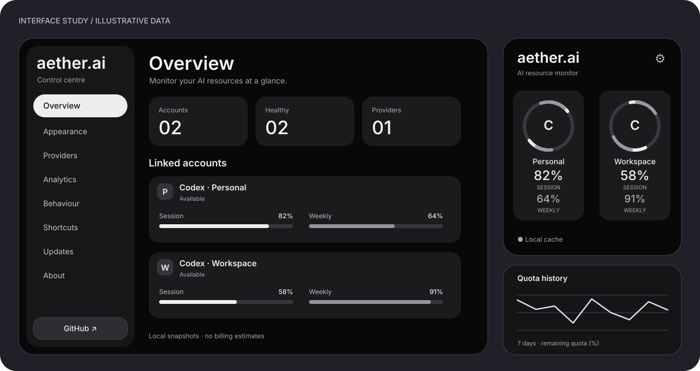
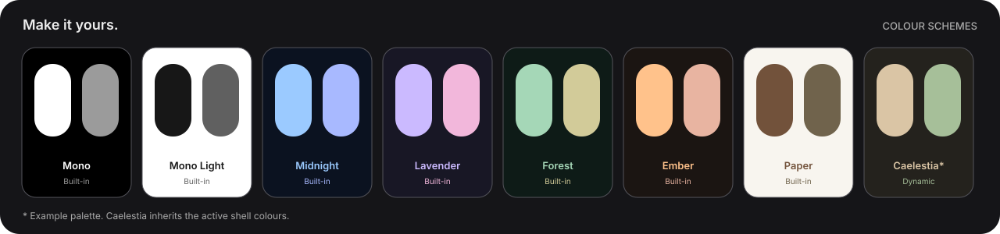
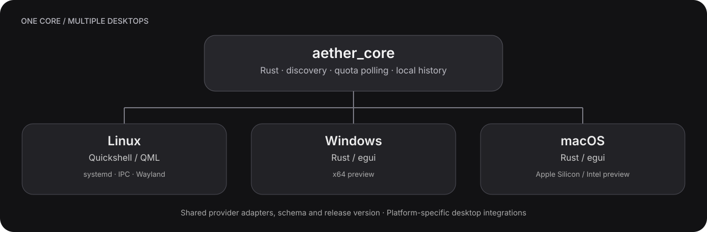

<div align="center">


[](https://github.com/maynkudu/aether-ai/actions/workflows/ci.yml)
[](LICENSE)
[](https://github.com/maynkudu/aether-ai/stargazers)
[](CHANGELOG.md)
[](Cargo.toml)

**A local-first AI quota monitor, designed to stay out of your way.**

[Website source](apps/web) · [Quick start](#quick-start) · [Features](#features) · [Platforms](#platforms) · [Docs](#documentation) · [Contribute](#contributing)

</div>

---

aether.ai brings your AI usage limits into one glanceable desktop interface. Track remaining Codex quota across multiple accounts, see how limits change over time, and keep your workflow in focus — without an inference proxy, hosted dashboard or telemetry.

Built with a shared Rust core, an independent Quickshell overlay for Linux, and an experimental native Rust/egui frontend for Windows and macOS.

> [!NOTE]
> **Early development (v0.2.0).** Codex is the only implemented quota adapter. Linux is the primary platform. Windows x64 and Apple Silicon / Intel macOS preview builds passed CI; physical-device testing remains pending. No stable GitHub release has been published yet.



<sub>Illustrative interface artwork with sample data, not a screenshot. Actual layout and colours depend on preferences.</sub>

## Meet Wisp


Wisp is our little companion for keeping AI quotas in view. The project is still **aether.ai**; Wisp is its mascot and visual identity. The original vector silhouette works at small icon sizes and in both monochrome themes. The native apps animate Wisp with occasional blinking, floating, breathing, expressions and a gentle halo. Animation can be disabled in Appearance; Linux Reduced motion also freezes Wisp.

[Brand assets and motion guide](docs/BRANDING.md) · [Animated SVG (download and open in browser)](docs/assets/branding/wisp-animated-light.svg)

## Features

| | |
|---|---|
| **At-a-glance quotas** — Session and weekly limits, reset information, grid cards and circular gauges. | **Multiple accounts** — Local Codex homes, experimental T3 discovery and independent visibility. |
| **Local analytics** — Real recorded quota history, line and bar views, 24h–90d ranges. | **Fluid interactions** — Corner-anchored drawer, spring motion, staggered pages, directional dropdowns and scroll fades. |
| **Personal by design** — Wisp, eight palettes, curated typefaces, configurable hotspots and shortcuts. | **Stay current** — Linux opt-in updates, Stable/Development channels and previous-build rollback. |

### Appearance



Linux supports Liquid, Smooth and Reduced motion, with opaque theme-aware surfaces and adjustable trackpad speed. Caelestia is optional and disabled when its prerequisites are missing. See [configuration](docs/CONFIGURATION.md).

## Platforms

| | Linux (Wayland) | Windows x64 | macOS ARM64 / Intel |
|---|---|---|---|
| Frontend | Quickshell / Qt Quick | Rust / egui | Rust / egui |
| Status | Primary development target | Experimental | Experimental |
| Codex & history | Implemented | Implemented; testing pending | Implemented; testing pending |
| Hover drawer, global hotkeys | Implemented | Planned | Experimental compact drawer and global shortcuts |
| Theme support | Eight schemes | Seven built-in schemes | Seven built-in schemes |
| Application updates | Opt-in updater | Planned | Experimental opt-in release updater |

Native previews use an independent polling worker; the macOS menu-bar preview can continue polling with the window minimized. Quit stops the process. The Linux daemon runs independently. No Electron or hosted service required.

### Provider support

| Group | Provider | Quota adapter |
|---|---|---|
| First-party agents | OpenAI Codex | Implemented |
| First-party agents | Claude Code, Grok | Planned |
| Harnesses / routing | OpenCode, Pi, OpenRouter | Planned |
| Aggregators | AgentRouter, FreeGG | Planned |
| Other providers | DeepSeek | Planned |

Artwork and provider visibility entries do not imply working quota integrations. See [account discovery](docs/CONFIGURATION.md#account-discovery).

## Quick start

### Linux

Requires Wayland, Quickshell with Qt 6.8+ popup APIs, Rust/Cargo, Git, Bash, Python 3.12+, systemd user services and native Codex CLI. Optional: ImageMagick and fontconfig. Hyprland is the primary target; Caelestia is not required.

```bash
git clone https://github.com/maynkudu/aether-ai.git
cd aether-ai
codex login
bash install.sh --fetch-icons --fetch-fonts
systemctl --user enable --now aether.service
qs -c aether
```

Hover over the top-right corner. Open the Control Centre using its gear icon, or from a separate terminal:

```bash
qs -c aether ipc call dashboard settings
```

[Full Linux guide →](docs/LINUX.md)

### Windows & macOS

Install and authenticate the native Codex CLI first. After a successful native build, download the matching experimental artifact from [GitHub Actions](https://github.com/maynkudu/aether-ai/actions).

| Target | Package |
|---|---|
| Windows x64 | `aether-windows-x64.zip` |
| Apple Silicon | `aether-macos-arm64.dmg` (or ZIP for older releases) |
| Intel Mac | `aether-macos-x64.dmg` (or ZIP for older releases) |

On Windows extract the archive and launch `aether-desktop.exe`. On macOS open the DMG, drag `aether.ai.app` to Applications and launch it there (older releases provide ZIPs). Windows builds are unsigned; macOS builds are ad-hoc signed, not notarized. Only run builds whose provenance you trust. Actions artifacts may require GitHub sign-in and can expire.

Build from source:

```bash
cargo run -p aether-desktop --release
```

[Desktop preview guide →](apps/desktop/README.md)

## CLI

```bash
aether accounts       # discovered account homes
aether usage          # cached quota JSON
aether history 7      # seven days of local history
aether version
```

`aether refresh` performs a provider probe; avoid running concurrently with the Linux daemon. Fish users can run `fish_add_path ~/.local/bin` if the CLI is not found.

## Updates & releases

| Channel | Tracks |
|---|---|
| Stable | Published, non-prerelease GitHub releases |
| Development | Commits on main |

On Linux, automatic installation is opt-in. Until the first stable release exists, choose Development for testing. Updates build from isolated upstream sources rather than modifying your checkout.

```bash
aether-update check development
aether-update apply development
aether-update rollback
```

See [updates and rollback](docs/LINUX.md#updates-and-rollback) and [release engineering](docs/RELEASING.md). CI automatically validates Linux and native desktop builds on version-tag pushes before drafting a release for manual review. Website checks also run on version tags. Both workflows can be started manually; ordinary pushes and pull requests do not trigger them.

## Architecture



One repository, one shared core, platform-specific integrations. The Linux installer and cache format retain their existing layout.

[Explore the architecture →](docs/ARCHITECTURE.md)

## Privacy & security

aether queries the native Codex app-server and reads local account configuration. It does not forward inference requests, upload quota history or collect telemetry. Codex may refresh its own authentication. Local caches contain account names, paths and quota percentages; treat them as private. Optional assets and update checks contact upstream services.

See [security policy](SECURITY.md) and [local data](docs/CONFIGURATION.md#local-data).

## Documentation

| Guide | Contents |
|---|---|
| [Linux installation](docs/LINUX.md) | Setup, systemd, IPC, shortcuts, updates and troubleshooting |
| [Configuration](docs/CONFIGURATION.md) | Themes, fonts, motion, scrolling, discovery and storage |
| [Desktop preview](apps/desktop/README.md) | Windows and macOS setup and limitations |
| [Architecture](docs/ARCHITECTURE.md) | Workspace structure and shared interfaces |
| [Release engineering](docs/RELEASING.md) | CI gates, versioning, builds and publication |
| [Changelog](CHANGELOG.md) | Development and release history |
| [Wisp branding](docs/BRANDING.md) | Mascot, vector assets and motion |
| [Brand assets](shell/BRAND-ASSETS.md) | Artwork provenance and third-party licenses |

## Roadmap

- [ ] Verify native Windows and macOS builds on real devices.
- [ ] Expand quota adapters beyond Codex; validate managed T3 credentials.
- [ ] Validate native macOS menu bar, drawer, hotkeys and updater on physical devices; bring tray and motion parity to Windows.
- [ ] Add signed distribution, dependency auditing and reproducible release builds.
- [ ] Validate scroll interaction and reduced-motion behaviour.

## Contributing

Focused improvements, bug reports and provider adapters are welcome. Start with [CONTRIBUTING.md](CONTRIBUTING.md). For visual feedback, include OS, compositor and a redacted screenshot or recording. Never attach credentials or private cache files.

[Report a bug](https://github.com/maynkudu/aether-ai/issues/new?template=bug_report.yml) · [Request a feature](https://github.com/maynkudu/aether-ai/issues/new?template=feature_request.yml)

## License & acknowledgements

MIT © [maynkudu](https://github.com/maynkudu). See [LICENSE](LICENSE).

Built with [Rust](https://www.rust-lang.org/), [Quickshell](https://quickshell.org/), [Qt Quick](https://www.qt.io/) and [egui](https://github.com/emilk/egui). Motion inspired by [Modulo](https://modulo.maynkudu.com/components/liquid-animations). Provider trademarks and third-party artwork retain their respective ownership and terms.

<div align="center">

**Intelligence, within limits.**

</div>
